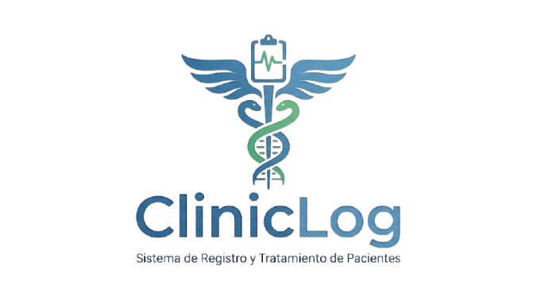

<p align="center">
  
</p>

<h1 align="center">Trabajos y Proyectos de Programación</h1>

<p align="center">
  Repositorio académico con ejercicios, prácticas y proyectos desarrollados en Python
</p>

---

## Descripción

Este repositorio contiene diferentes trabajos, ejercicios y proyectos desarrollados durante la carrera de Ingeniería de Sistemas.

Los archivos están organizados de acuerdo con las actividades realizadas en clase, incluyendo ejercicios de programación, estructuras de datos, recursividad y proyectos prácticos.

El objetivo principal es almacenar y documentar el aprendizaje adquirido mediante la implementación de soluciones en Python.

---

## Contenido del repositorio

- Ejercicios básicos de programación en Python.
- Prácticas relacionadas con estructuras de datos.
- Ejercicios de pilas y colas.
- Implementaciones de recursividad.
- Proyectos académicos.
- Notebooks desarrollados en Jupyter.
- Archivos de documentación y pruebas.
- Archivos de texto utilizados por algunos ejercicios.

---

## Proyectos incluidos

### Mini Proyecto 1 - ClinicLog

ClinicLog es un sistema de consola para registrar pacientes, asociar tratamientos y llevar un seguimiento básico mediante observaciones de tomas, visitas o controles.

Entre sus principales funciones se encuentran:

- Registrar pacientes.
- Registrar tratamientos asociados a un paciente.
- Consultar pacientes y tratamientos.
- Registrar seguimientos.
- Validar los datos ingresados.
- Controlar opciones y entradas inválidas.

### Mini Proyecto 2 - ClinicLog

Segunda versión o avance del proyecto ClinicLog, acompañado de archivos de código fuente, documentación y un notebook de Jupyter.

---

## Carpetas principales

```text
assets/
Colas-Semana5-Grupo4/
Ejercicios de Pila/
Mini Proyecto 2 ClinicLog/
Mini Proyecto ClinicLog/
Prueba/
U7_recursividad/
```

---

## Tecnologías utilizadas

- Python
- Jupyter Notebook
- Git
- GitHub

---

## Requisitos

Para ejecutar los ejercicios y proyectos se necesita:

- Python 3 o una versión superior.
- Jupyter Notebook, en caso de utilizar archivos `.ipynb`.
- Un editor de código como Visual Studio Code.
- Git, si se desea clonar o actualizar el repositorio.

---

## Estructuras de datos y temas trabajados

Durante el desarrollo de los ejercicios se abordan temas como:

- Variables y tipos de datos.
- Condicionales.
- Ciclos.
- Funciones.
- Manejo de archivos.
- Programación orientada a objetos.
- Pilas.
- Colas.
- Recursividad.
- Validación de datos.
- Organización de proyectos.

---

## Asignatura

Programación con Estructuras de Datos  
Ingeniería en Sistemas de Información  
UNAN-Managua